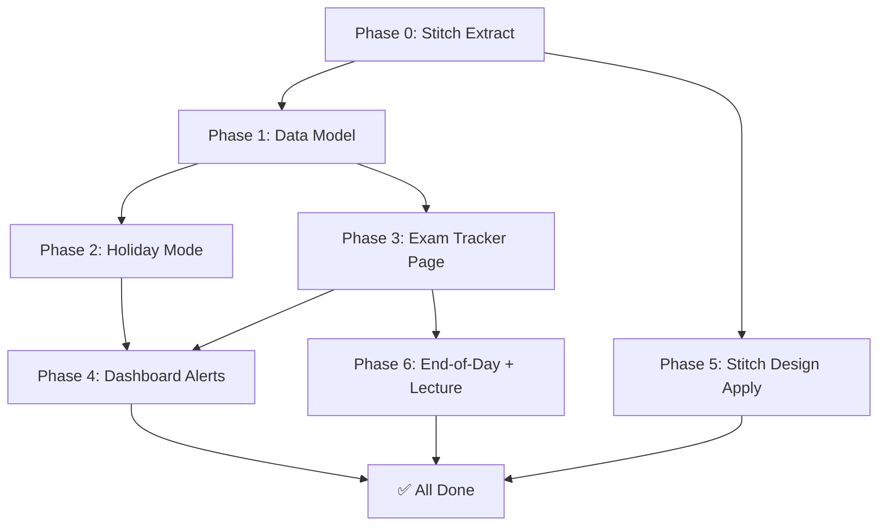

# PLAN.md — Revision OS: Full Feature Build
**Status:** READY TO EXECUTE  
**Created:** 2026-10-11  
**Source specs:** PREP_README.md · EXAM_TRACKER.md · Stitch design (to be extracted per Phase 0)

---

## What Exists Today

The app (`src/main.jsx`, 2388 lines, single-file React/Vite) already has:

| Page | Status |
|------|--------|
| Dashboard | ✅ Working — shows today's classes, overdue tasks, upcoming work |
| Timetable | ✅ Working — editable slots, course-code mapping |
| Course Library | ✅ Working — course list with assignments |
| Revision Planner | ✅ Working — spaced repetition tasks, backlog |
| Analytics | ✅ Working — basic charts |

**What is MISSING (from EXAM_TRACKER.md spec):**

| Feature | Status |
|---------|--------|
| Exam Calendar page | ❌ Not built |
| Assessment records (Quiz 1/Midsem/Quiz 2/Endsem/Lab/Assignment/Other) | ❌ Not built |
| Marks & performance tracking | ❌ Not built |
| Subject priority score (explainable 0–100) | ❌ Not built |
| Main-screen exam alerts | ⚠️ Partial (assignments only, no exam countdown) |
| Normalized Supabase schema for assessments | ❌ Not built |
| Holiday mode | ❌ Missing from current app |
| Stale-log per-course tracking (>2 eligible days) | ⚠️ Partially seeded, needs enforcement |

**What needs improvement (from PREP_README.md):**

| Feature | Status |
|---------|--------|
| Lecture status as persisted toggle (not just badge) | ⚠️ Check UI — currently uses classLog |
| Same-day revision task auto-create on topic entry | ⚠️ Partial |
| End-of-day checklist summary view | ❌ Missing |
| Assignment alerts: overdue / 48h / 7d | ⚠️ Partial |
| Holiday toggle per date | ❌ Missing |
| Stale class log counter (eligible teaching days only) | ⚠️ Partially computed |
| Export/backup including assessments and marks | ⚠️ Basic export exists, no assessment data |

---

## Architecture Decisions

- **Single-file approach preserved**: Continue adding to `src/main.jsx` — codebase is intentionally monolithic for simplicity
- **New page added**: `exams` — Exam Calendar & Tracker
- **Data model extended**: Add `assessments` and `holidays` arrays to app state
- **Supabase schema extended**: New tables for assessments (in `supabase/schema.sql`)
- **Stitch designs**: Apply visual tokens (colors, typography) extracted from Stitch to CSS overrides — adapt HTML/CSS output into React
- **Priority score**: Implemented as a pure function in `main.jsx`, no AI calls

---

## Phase 0 — Stitch Design Extract (Pre-requisite)

**Goal:** Extract design tokens, screen layouts, and HTML/CSS from Stitch MCP before coding begins.

> [!IMPORTANT]
> This is the FIRST step. Do not write code until design is extracted and saved.

### Tasks

| # | Task | Action |
|---|------|--------|
| 0.1 | List Stitch projects | Use `list_projects` MCP tool |
| 0.2 | Identify Revision OS project | Use `get_project` on the revision-os project ID |
| 0.3 | List screens | Use `list_screens` to enumerate all screens |
| 0.4 | Extract each screen's HTML/CSS | Use `get_screen_code` for every screen |
| 0.5 | Extract design tokens | Use `list_design_systems` and `create_design_system` details |
| 0.6 | Save extract to file | Write to `.gsd/STITCH_DESIGN.md` |

### Output

File: `.gsd/STITCH_DESIGN.md`  
Contents: design tokens, per-screen HTML/CSS, color palette, typography scale

---

## Phase 1 — Data Model & State Extension

**Goal:** Extend app state and Supabase schema to support assessments and holidays.  
**Wave:** 1 (no dependencies)  
**Commit prefix:** `feat(phase-1)`

### Tasks

#### P1.T1 — Add `assessments` to app state + initialData

**File:** `src/initialData.js`

Add seeded assessment records for each course × type:

```js
export const DEFAULT_ASSESSMENTS = [
  // For each course: Quiz 1, Midsem, Quiz 2, Endsem seeded with null dates/marks
  {
    id: '<uuid>',
    courseId: 'ME 311',
    title: 'Quiz 1',
    type: 'Quiz 1',
    scheduledAt: null,       // blank until student enters
    status: 'tentative',     // tentative | confirmed | completed | postponed | cancelled
    marksObtained: null,
    maxMarks: null,
    weightagePercent: null,
    syllabus: '',
    notes: '',
    createdAt: '<iso>',
    updatedAt: '<iso>'
  },
  // ... Midsem, Quiz 2, Endsem for ME 311
  // ... repeat for ME 312, ME 313, ME 314, ME 315, EE 380, HS 1xx, HSS-GT
];
```

**Validation rules to encode:**
- `marksObtained >= 0`
- If both marks present: `marksObtained <= maxMarks` (unless `extraCredit = true`)
- `weightagePercent` between 0–100
- Date edits must immediately update countdown

**Commit:** `feat(phase-1): add DEFAULT_ASSESSMENTS seed data to initialData.js`

---

#### P1.T2 — Add `holidays` to app state

**File:** `src/initialData.js`

```js
export const DEFAULT_HOLIDAYS = [];
// Shape: { id, date: 'YYYY-MM-DD', label: string, isRange: false }
// Range: { id, startDate, endDate, label, isRange: true }
```

**Commit:** `feat(phase-1): add DEFAULT_HOLIDAYS to initialData.js`

---

#### P1.T3 — Wire assessments + holidays into getInitialState()

**File:** `src/main.jsx`  
**Lines:** ~50–100 (getInitialState function)

- Import `DEFAULT_ASSESSMENTS`, `DEFAULT_HOLIDAYS` from `initialData.js`
- Add to state object: `assessments: [...], holidays: [...]`
- Persist/restore from localStorage key `revision_os_state_v2`
- Include in Supabase save/load payload

**Commit:** `feat(phase-1): wire assessments and holidays into app state`

---

#### P1.T4 — Extend Supabase schema for assessments

**File:** `supabase/schema.sql`

Add normalized tables (alongside existing `revision_os_data`):

```sql
-- Assessments table (normalized, per EXAM_TRACKER.md spec)
create table if not exists public.assessments (
  id uuid primary key default gen_random_uuid(),
  user_id uuid not null references auth.users(id) on delete cascade,
  course_id text not null,
  title text not null,
  type text not null check (type in ('Quiz 1','Midsem','Quiz 2','Endsem','Assignment','Lab/Practical','Other')),
  scheduled_at timestamptz,
  status text not null default 'tentative' check (status in ('tentative','confirmed','completed','postponed','cancelled')),
  marks_obtained numeric check (marks_obtained >= 0),
  max_marks numeric check (max_marks > 0),
  weightage_percent numeric check (weightage_percent between 0 and 100),
  extra_credit boolean not null default false,
  syllabus text,
  notes text,
  created_at timestamptz not null default now(),
  updated_at timestamptz not null default now()
);

create index if not exists idx_assessments_user_date on public.assessments (user_id, scheduled_at);
create index if not exists idx_assessments_user_course on public.assessments (user_id, course_id);

alter table public.assessments enable row level security;

-- RLS policies
create policy "Users read own assessments" on public.assessments
  for select to authenticated using (auth.uid() = user_id);
create policy "Users insert own assessments" on public.assessments
  for insert to authenticated with check (auth.uid() = user_id);
create policy "Users update own assessments" on public.assessments
  for update to authenticated using (auth.uid() = user_id);
create policy "Users delete own assessments" on public.assessments
  for delete to authenticated using (auth.uid() = user_id);

grant select, insert, update, delete on public.assessments to authenticated;

-- Holidays table
create table if not exists public.holidays (
  id uuid primary key default gen_random_uuid(),
  user_id uuid not null references auth.users(id) on delete cascade,
  date date,
  start_date date,
  end_date date,
  label text,
  is_range boolean not null default false,
  created_at timestamptz not null default now()
);

alter table public.holidays enable row level security;
create policy "Users manage own holidays" on public.holidays
  for all to authenticated using (auth.uid() = user_id);
grant select, insert, update, delete on public.holidays to authenticated;
```

**Commit:** `feat(phase-1): extend supabase schema for assessments and holidays`

---

#### P1.T5 — Add course priority scoring function

**File:** `src/main.jsx`  
**Location:** Add as a standalone pure function before App()

```js
/**
 * Compute explainable priority score 0–100 per course.
 * Formula (EXAM_TRACKER.md §3):
 *   35% weakness + 25% exam urgency + 20% backlog + 10% syllabus incomplete + 10% stale class log
 * Missing data: redistribute weight proportionally, label score "provisional".
 */
function computePriorityScore(course, assessments, tasks, classLog, holidays, today) {
  // Returns: { score: number, label: string, provisional: boolean, breakdown: {...} }
}
```

Priority labels:
- **Must do**: 70–100 or overdue/high-risk assessment
- **High**: 50–69
- **Normal**: 25–49
- **Maintain**: 0–24

**Commit:** `feat(phase-1): add computePriorityScore pure function`

---

### Phase 1 Verification

```bash
# App builds without errors
npm run build
# No TypeErrors on state load (check browser console)
# assessments and holidays appear in localStorage under revision_os_state_v2
```

---

## Phase 2 — Holiday Mode UI

**Goal:** Add per-date holiday toggle to daily planner.  
**Wave:** 2 (depends on Phase 1 state)  
**Commit prefix:** `feat(phase-2)`

### Tasks

#### P2.T1 — Holiday toggle on Daily Planner header

**File:** `src/main.jsx`  
**Component:** DailyPlanner (or wherever `selectedDate` is rendered in planner page)

- Add **"Mark as Holiday"** toggle button next to date navigator
- Shows holiday label input when toggled on
- Persists to `data.holidays`
- Turning off removes the holiday record for that date

**Behavior rules:**
- Holiday dates: do not count as missed class, do not increment stale-log counter
- Existing tasks/assignments remain visible (no auto-complete)
- Reschedule offer shown for overdue items on holiday

**Commit:** `feat(phase-2): add holiday toggle to daily planner header`

---

#### P2.T2 — isHoliday() utility + stale-log fix

**File:** `src/main.jsx`

```js
function isHoliday(date, holidays) {
  return holidays.some(h =>
    h.isRange
      ? date >= h.startDate && date <= h.endDate
      : h.date === date
  );
}

// Fix staleness calculation to skip holidays and weekends
function staleDays(courseId, slots, classLog, holidays, today) {
  // Count eligible teaching days (course has slot, not holiday, not weekend)
  // where class is not logged
}
```

**Commit:** `feat(phase-2): add isHoliday utility and fix stale-log calculation`

---

#### P2.T3 — Dashboard alerts: holiday-aware

**File:** `src/main.jsx`  
**Component:** Dashboard alert list

- Stale-log alerts now skip holidays
- If today is a holiday, show a holiday banner; suppress "log your classes" alert
- Do NOT suppress overdue assessment/assignment alerts on holidays

**Commit:** `feat(phase-2): make dashboard alerts holiday-aware`

---

### Phase 2 Verification

```bash
npm run build
# Manual test: mark a date as holiday → stale counter does not increment
# Dashboard shows holiday banner, not "log your classes" alert
```

---

## Phase 3 — Exam Calendar & Tracker Page

**Goal:** Build the full Exam Calendar + Marks tracker (EXAM_TRACKER.md §1–2).  
**Wave:** 2 (depends on Phase 1 state)  
**Commit prefix:** `feat(phase-3)`

### Tasks

#### P3.T1 — Add "Exam Tracker" to nav

**File:** `src/main.jsx`  
**Lines:** ~484–490 (navItems array)

```js
{ id: 'exams', label: 'Exam Tracker', icon: GraduationCap },
```

Add page render:
```jsx
{page === 'exams' && (
  <ExamTrackerPage data={data} onUpdate={update} />
)}
```

**Commit:** `feat(phase-3): add Exam Tracker nav item and page shell`

---

#### P3.T2 — ExamTrackerPage component

**File:** `src/main.jsx` (add as new function component)

**Sub-views (tabs within page):**
1. **Calendar** — chronological list + month view
2. **Marks** — marks/performance history per course
3. **Priority** — subject priority ranking

**Calendar view features:**
- Chronological list of upcoming assessments
- Month grid with assessment dots
- Filters: course, type (Quiz 1/Midsem/etc.), status
- Highlight: overdue (red), within 7 days (orange), within 14 days (yellow)
- "Date not announced" section for assessments with null scheduledAt
- **Add Assessment** button → modal
- Per-assessment: **Edit**, **Mark Completed**, **Delete** (confirm → archive option)

**Assessment card actions:**
```jsx
// Edit → AssessmentFormModal (all fields editable)
// Mark Completed → prompt for marks if not entered
// Delete → confirm dialog with "Archive instead?" option
// Postpone → date picker opens inline
```

**Commit:** `feat(phase-3): build ExamTrackerPage with calendar view`

---

#### P3.T3 — AssessmentFormModal component

**File:** `src/main.jsx`

Fields:
- Course (select from `data.courses`)
- Title (text, required)
- Type (Quiz 1 / Midsem / Quiz 2 / Endsem / Assignment / Lab/Practical / Other)
- Date & time (datetime-local, optional)
- Status (tentative / confirmed / completed / postponed / cancelled)
- Marks obtained (number, optional)
- Max marks (number, optional)
- Weightage % (number 0–100, optional)
- Extra credit toggle (enables marksObtained > maxMarks)
- Syllabus (textarea)
- Notes (textarea)

**Validation:**
- marksObtained ≥ 0
- marksObtained ≤ maxMarks unless extraCredit
- weightagePercent 0–100

**Commit:** `feat(phase-3): add AssessmentFormModal with full field validation`

---

#### P3.T4 — Marks & Performance view

**File:** `src/main.jsx` (tab within ExamTrackerPage)

Per course:
- Assessment history table: date | type | title | marks | % | weightage
- % only shown when both marks fields are non-null and maxMarks > 0
- Missing marks shown as "—" never "0"
- Allow editing marks inline (pencil icon → inline number inputs)
- Course totals: weighted average (only across assessments with all data)

**Commit:** `feat(phase-3): add Marks and Performance tab to ExamTrackerPage`

---

#### P3.T5 — Priority view (Subject Priority page within Exam Tracker)

**File:** `src/main.jsx`

Uses `computePriorityScore()` from Phase 1.

Per course card shows:
- Priority label (Must do / High / Normal / Maintain)
- Score bar 0–100
- Score breakdown: weakness / exam urgency / backlog / syllabus / stale log
- "Provisional" badge if any data source is missing
- Inline confidence slider (1–5)
- Inline syllabus completion slider (0–100%)
- Inline self-rated difficulty (Low / Medium / High)
- Manual override toggle: student can set priority label manually; auto score remains visible

**Commit:** `feat(phase-3): add Subject Priority tab with explainable scores`

---

### Phase 3 Verification

```bash
npm run build
# Open /exams page
# Add an assessment → appears in list
# Edit marks → percentage calculates correctly
# Missing marks show "—" not "0"
# Priority score shown with breakdown
```

---

## Phase 4 — Dashboard Exam Alerts

**Goal:** Surface exam alerts on main Dashboard per EXAM_TRACKER.md §4 and PREP_README.md.  
**Wave:** 3 (depends on Phase 3)  
**Commit prefix:** `feat(phase-4)`

### Tasks

#### P4.T1 — Exam alert computation

**File:** `src/main.jsx`

Compute these alert categories from `data.assessments`:
1. Assessment overdue or happening today
2. Confirmed exam within 7 days
3. Assignment due within 48 hours
4. Assignment due within 7 days
5. Course not logged > 2 eligible teaching days (holiday-aware)
6. Weak course: confidence ≤ 2 or recent mark < 40%

**Rules:**
- Each alert explains why it appears (e.g., "Quiz 1 in 3 days — ME 311")
- Links to relevant course/assessment
- No duplicate alerts for same issue
- Priority ordering per PREP_README.md §"Daily planner and priority order"

**Commit:** `feat(phase-4): add exam-aware alert computation to dashboard`

---

#### P4.T2 — Alert UI on Dashboard

**File:** `src/main.jsx`  
**Component:** Dashboard

- Move existing assignment alerts into unified alert list
- Color-coded severity: red (overdue/today), orange (48h/7d exam), yellow (7d assignment), blue (info)
- Each alert: icon + message + link/action button
- Collapse if >5 alerts (show top 5, "Show all" expander)

**Commit:** `feat(phase-4): unified exam+assignment+stale-log alert UI on dashboard`

---

#### P4.T3 — Export/backup includes assessments + marks

**File:** `src/main.jsx`  
**Location:** Export function (currently on Timetable page)

Extend JSON export to include:
```json
{
  "version": 3,
  "exportedAt": "...",
  "courses": [...],
  "slots": [...],
  "mappings": {...},
  "holidays": [...],
  "classLog": [...],
  "topics": [...],
  "tasks": [...],
  "assessments": [...]
}
```

Update import to handle version 3 shape. Keep backward compat with v2.

**Commit:** `feat(phase-4): extend export/import to include assessments and holidays`

---

### Phase 4 Verification

```bash
npm run build
# Dashboard shows exam alert: "Quiz 1 in 3 days — Heat Transfer"
# Export JSON includes assessments array
# Import restores assessments correctly
```

---

## Phase 5 — Stitch Design Application

**Goal:** Apply Stitch visual design tokens to the app's CSS.  
**Wave:** 4 (depends on Phase 0 extract, can run parallel to Phase 3–4)  
**Commit prefix:** `feat(phase-5)`

> [!NOTE]
> This phase depends on Phase 0 (Stitch design extract). The HTML/CSS from Stitch screens is adapted into the existing React component structure — we do NOT replace the component logic, only the visual styling.

### Tasks

#### P5.T1 — Apply design tokens to CSS variables

**File:** `src/styles.css`

Map Stitch design tokens to CSS custom properties:
```css
:root {
  --color-primary: <from Stitch>;
  --color-surface: <from Stitch>;
  --color-text: <from Stitch>;
  --font-heading: <from Stitch>;
  --radius-card: <from Stitch>;
  /* ... */
}
```

**Commit:** `feat(phase-5): apply stitch design tokens to css variables`

---

#### P5.T2 — Apply Stitch screen layouts to components

**File:** `src/main.jsx` (JSX className updates) + `src/styles.css`

For each Stitch screen:
- Map the HTML structure to corresponding React component
- Apply Tailwind/CSS class names from `get_screen_code` output
- Preserve all React logic, only update classNames and structure

**Commit:** `feat(phase-5): apply stitch screen layouts to react components`

---

#### P5.T3 — Visual QA pass

- Check all 5 pages + Exam Tracker in dark/light mode
- Verify responsive layout on mobile viewport (375px) and desktop (1280px)
- Confirm Stitch design fidelity matches extracted screens

**Commit:** `feat(phase-5): visual QA fixes after stitch design application`

---

## Phase 6 — End-of-Day Checklist & Lecture Status Improvements

**Goal:** Complete remaining PREP_README.md requirements.  
**Wave:** 3 (can run parallel to Phase 4)  
**Commit prefix:** `feat(phase-6)`

### Tasks

#### P6.T1 — End-of-day checklist view

**File:** `src/main.jsx`

Add "End of Day" section/modal (accessible from Daily Planner):
- List every scheduled class for the day
- Each item: status toggle (Not logged / Ongoing / Completed / Missed)
- Summary at bottom:
  - Classes logged X / Y scheduled
  - Topics revised X / Y due
  - Tasks carried forward: X
  - Assignments approaching: list titles + days
  - Subjects needing attention: list by priority

**Commit:** `feat(phase-6): add end-of-day checklist view to daily planner`

---

#### P6.T2 — Persisted lecture status (confirm it's a real select, not just badge)

**File:** `src/main.jsx`  
**Audit:** Read the class log section and verify `status` is a `<select>` or button-group, not just a display label.

If it's just a visual badge → convert to interactive select persisted in `classLog`.

**Commit:** `feat(phase-6): ensure lecture status is persisted interactive control`

---

#### P6.T3 — Same-day revision task auto-create

**File:** `src/main.jsx`

When user enters a topic in a class log entry:
- Auto-create a revision task with `dueDate = today`
- Task links back to topic ID
- Do NOT auto-create if topic already has a pending same-day task
- Show confirmation: "Revision task created for [topic]"

**Commit:** `feat(phase-6): auto-create same-day revision task on topic entry`

---

## Execution Order Summary



---

## Acceptance Checklist (from both READMEs)

### EXAM_TRACKER.md

- [ ] Every course has Quiz 1, Midsem, Quiz 2, Endsem records (seeded, editable)
- [ ] Student can add, edit, reschedule, complete, cancel, archive or delete an assessment
- [ ] Dates and countdowns update after edits
- [ ] Past marks and maximum marks are editable and percentages are calculated safely
- [ ] Unknown dates and marks remain blank (not zero, not fabricated)
- [ ] Main screen surfaces imminent assessments and due assignments
- [ ] Priority is explainable, based on student-entered evidence, manually overridable
- [ ] Exam and marks data persists across devices through authenticated database
- [ ] Data export/backup includes assessments and marks

### PREP_README.md

- [ ] Timetable from the uploaded image is preloaded and editable
- [ ] Unconfirmed course-code mappings are visually obvious and editable
- [ ] HSS Game Theory exists as a separate course option
- [ ] Each scheduled class has a persistent Not logged / Ongoing / Completed / Class missed status
- [ ] Student can enter today's topic and create a same-day revision task
- [ ] Holiday toggle excludes dates from missed-class/stale-log calculations
- [ ] A course not logged for more than two eligible teaching days appears in Must do today
- [ ] Assignments support due dates, status, editing and deadline alerts
- [ ] Old topics remain in a backlog until completed or explicitly rescheduled
- [ ] Lecture completion and revision completion are separate states
- [ ] All changes persist across devices after signing into the same account
- [ ] Main dashboard explains why each task or subject has priority
- [ ] Export/backup includes timetable, mappings, holidays, logs, topics, assignments, exams and marks

---

## Key Constraints (Never Violate)

1. **No fabricated dates or marks** — blank = not entered, never auto-fill
2. **No priority from course name** — priority only from student-entered data
3. **Holiday dates excluded** from stale-log and missed-class counts
4. **Marks validation**: obtained ≤ max (unless extraCredit), both ≥ 0
5. **Lecture status ≠ revision status** — two separate fields, two separate states
6. **No service-role key in browser** — Supabase anon key only
7. **MINOR stays unmapped** until student confirms it

---

## Files to Touch

| File | Phase | Nature of Change |
|------|-------|-----------------|
| `src/initialData.js` | 1 | Add DEFAULT_ASSESSMENTS, DEFAULT_HOLIDAYS |
| `src/main.jsx` | 1–6 | Extend state, add components, fix alerts |
| `src/styles.css` | 5 | Apply Stitch design tokens |
| `supabase/schema.sql` | 1 | Add assessments + holidays tables |
| `.gsd/STITCH_DESIGN.md` | 0 | Create (Stitch extract output) |

---

*Ready to execute. Run Phase 0 (Stitch Extract) first, then Phase 1.*
